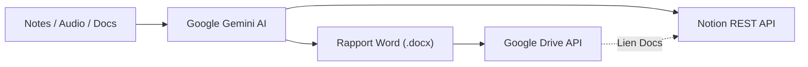

# ReportFlow

Plateforme d'automatisation pour la synthèse de réunions, la génération de comptes-rendus Word et la synchronisation continue vers Notion et Google Drive, propulsée par Google Gemini.

---

## Présentation

**ReportFlow** est une application web conçue pour automatiser l'intégralité du traitement post-réunion. 

À partir de notes brutes, de documents bureautiques (PDF, Word) ou d'enregistrements audio pouvant atteindre **2 heures (200 Mo)**, l'application extrait les informations critiques via l'IA multimodale, produit un rapport Word (`.docx`) structuré et assure une double synchronisation vers **Notion** et **Google Drive**.



---

## Fonctionnalités Principales

### Traitement Multimodal & Audio Longue Durée
* Prise en charge des enregistrements audio de réunions (`.mp3`, `.m4a`, `.wav`, `.aac`, `.ogg`, `.flac`, `.webm`) jusqu'à **200 Mo** (~2 heures).
* Analyse native de documents PDF vectoriels, extraction textuelle de fichiers Word (`.docx`) et texte brut (`.txt`).
* Éditeur de saisie directe avec compteurs de mots et de caractères en temps réel et raccourci clavier (`Ctrl + Entrée`).

### Architecture IA Résiliente
* **Traitement en mémoire vive (< 20 Mo)** : Ingestion directe en Base64 (`inlineData`) sans écriture sur disque pour une latence minimale.
* **Support haute capacité (≥ 20 Mo)** : Téléversement via l'API Google Files (`ai.files.upload`) avec suppression systématique des fichiers temporaires locaux et distants dans un bloc `finally`.
* **Stratégie de secours multi-modèles (Fallback)** : Basculement séquentiel automatique en cas de charge élevée (`gemini-2.5-flash` → `gemini-2.0-flash` → `gemini-3.8-flash`).

### Génération de Documents Word (.docx)
* Assemblage binaire 100 % en mémoire vive (RAM) via la librairie `docx` (zéro I/O disque).
* Mise en page exécutive : métadonnées de réunion, typographie hiérarchisée, synthèse rédigée et plan d'action sous forme de puces.

### Double Synchronisation Cloud : Google Drive & Notion
* **Google Drive & Google Docs** : Téléversement du fichier via flux continu (`stream.PassThrough`), attribution des droits collaboratifs (`role: writer`) et génération automatique d'un lien d'édition directe (`webViewLink`).
* **Base de données Notion** : Insertion normalisée des métadonnées (`Client / Projet`, `Date`, `Synthèse IA`, `Actions à mener` et `Document source (Drive)`).

### Interface Utilisateur Sobre & Réactive
* **Hub d'état Cloud** : Badges d'état connectés pour Google Drive et Notion avec liens directs vers votre dossier et votre base de données.
* **Checklist interactive** : Suivi des tâches de réunion avec cases à cocher fonctionnelles.
* **Actions rapides** : Accès direct à la fiche Notion, ouverture immédiate dans Google Docs et téléchargement du livrable `.docx`.

---

## Architecture du Projet

```text
ReportFlow/
├── index.js                     # Point d'entrée Express, configuration Multer et routage HTTP
├── services/
│   ├── geminiService.js         # Client IA Gemini, analyse multimodale et chaîne de secours
│   ├── wordService.js           # Moteur de génération de documents Word (.docx) en RAM
│   ├── googleDriveService.js    # Client Google Drive API (OAuth 2.0 & Service Account)
│   └── notionService.js         # Client REST Notion (Axios) et persistance des données
├── scripts/
│   └── connecter-drive.js       # Script d'autorisation OAuth 2.0 locale (Port 3001)
├── views/
│   └── index.ejs                # Vue principale EJS (Tailwind CSS, Lucide Icons)
├── public/
│   └── js/app.js                # Contrôleur client asynchrone (FormData, Fetch API)
└── .env.example                 # Modèle des variables d'environnement requises
```

### Technologies Utilisées

| Composant | Technologie | Rôle |
| :--- | :--- | :--- |
| **Backend** | Node.js, Express 5 | Serveur HTTP et orchestration d'API |
| **Ingestion fichiers** | Multer (`memoryStorage`) | Traitement sécurisé en mémoire vive |
| **Intelligence Artificielle** | `@google/genai` (Gemini Flash) | Analyse audio, lecture documentaire et extraction JSON |
| **Génération Bureautique** | `docx` | Fabrication du document Word officiel en RAM |
| **Stockage Cloud** | `googleapis` (Drive v3) | Téléversement sécurisé, permissions et URL Google Docs |
| **Extraction Word** | Mammoth | Conversion des fichiers `.docx` sources en texte brut |
| **Persistance Notion** | Axios, Notion REST API (`2022-06-28`) | Création des fiches dans la base cible |
| **Interface Utilisateur** | EJS, Tailwind CSS, Lucide Icons | Rendu dynamique et composants interactifs |

---

## Installation et Démarrage

### Prérequis

* [Node.js](https://nodejs.org/) (version 18 ou supérieure recommandée)
* Une clé d'API Google Gemini ([Google AI Studio](https://aistudio.google.com/))
* Une intégration interne Notion avec accès à une base de données ([Notion Developers](https://developers.notion.com/))
* Un projet Google Cloud avec l'API Google Drive activée ([Google Cloud Console](https://console.cloud.google.com/))

### 1. Cloner le projet et installer les dépendances

```bash
git clone https://github.com/votre-compte/reportflow.git
cd reportflow
npm install
```

### 2. Configurer les variables d'environnement

Copiez le fichier d'exemple et remplissez vos identifiants :

```bash
cp .env.example .env
```

Contenu requis dans `.env` :

```env
PORT=3000

# Intelligence Artificielle (Google Gemini)
GEMINI_API_KEY=votre_cle_api_gemini

# Base de données Notion
NOTION_TOKEN=ntn_votre_token_notion
DATABASE_ID=votre_identifiant_base_notion

# Stockage Cloud Google Drive (OAuth 2.0)
GOOGLE_DRIVE_FOLDER_ID=votre_identifiant_dossier_drive
GOOGLE_CLIENT_ID=votre_client_id.apps.googleusercontent.com
GOOGLE_CLIENT_SECRET=votre_client_secret
```

> [!NOTE]
> Dans Notion, assurez-vous que votre base de données contient les colonnes suivantes :
> `Client / Projet` (Titre), `Date` (Date), `Synthèse IA` (Texte enrichi), `Actions à mener` (Texte enrichi) et `Document source (Drive)` (URL).
> N'oubliez pas d'associer votre intégration à la page via le menu `...` > `Connexions`.

### 3. Autoriser l'accès à Google Drive (Une seule fois)

Pour permettre le dépôt des documents sur votre Google Drive personnel en utilisant votre quota :

```bash
npm run auth:drive
```

Une page s'ouvre automatiquement dans votre navigateur pour valider la connexion. Le script enregistre automatiquement le jeton permanent `GOOGLE_REFRESH_TOKEN` dans votre fichier `.env`.

### 4. Lancer le serveur

En mode développement (avec rechargement automatique via Nodemon) :

```bash
npm run dev
```

En mode production :

```bash
npm start
```

L'application est accessible à l'adresse suivante : `http://localhost:3000`.

---

## Sécurité et Confidentialité

* **Exclusion Git stricte** : Le fichier `.env`, les clés privées et les documents internes sont exclus du dépôt via `.gitignore`.
* **Traitement en mémoire vive** : Pour les notes et les documents standards (< 20 Mo), aucune donnée n'est écrite sur le disque du serveur hôte.
* **Cycle de vie éphémère** : Pour les fichiers volumineux (≥ 20 Mo), la suppression des fichiers temporaires locaux et distants est garantie dans un bloc `finally`.
* **Principe du moindre privilège** : L'accès à Google Drive est strictement restreint au répertoire ciblé (`GOOGLE_DRIVE_FOLDER_ID`).

---

## Licence

Ce projet est distribué sous licence MIT. Consultez le fichier [LICENSE](LICENSE) pour plus d'informations.
