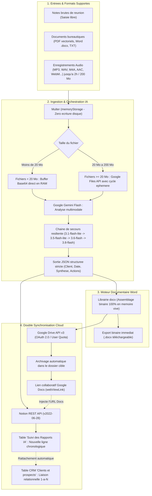

# ReportFlow ⚡

> **Plateforme d'automatisation post-réunion : Ingestion multimodale (audio jusqu'à 2h, Word, PDF), structuration par IA (Google Gemini), génération de livrables Word officiels en mémoire vive et double synchronisation Cloud (Notion CRM relationnel & Google Drive).**

[](https://nodejs.org/)
[](https://expressjs.com/)
[](https://aistudio.google.com/)
[](https://developers.notion.com/)
[](https://developers.google.com/drive)
[](LICENSE)

---

## 🎯 Contexte Métier & Pourquoi ReportFlow ?

### Le Problème Concret
Après chaque réunion commerciale, comité de pilotage ou session de cadrage, les professionnels (**consultants, chefs de projet, directeurs de clientèle, équipes commerciales**) perdent en moyenne **30 à 45 minutes** en tâches administratives chronophages :
1. Déchiffrer des notes manuscrites disparates ou réécouter des enregistrements audio de plus d'une heure.
2. Mettre en forme manuellement un document Word conforme aux standards de l'entreprise.
3. Téléverser le fichier sur Google Drive et gérer les droits de partage.
4. Mettre à jour le CRM d'équipe (Notion) : créer la fiche de réunion, saisir le résumé, isoler les actions prioritaires et lier la réunion au compte client correspondant.

### La Solution ReportFlow
**ReportFlow** convertit ce processus manuel en une opération instantanée et sans friction :
* **Ingestion universelle** : Vous collez vos notes brutes ou déposez un enregistrement audio (jusqu'à 2 heures / 200 Mo).
* **Extraction intelligente** : L'IA Google Gemini identifie le client, la date, rédige une synthèse exécutive structurée et extrait une to-do list d'actions exploitables.
* **Production bureautique en RAM** : Un livrable Word (`.docx`) professionnel et prêt à envoyer est généré à la volée.
* **Double ancrage Cloud automatique** :
  * Le document est archivé sur **Google Drive** avec génération d'un lien d'édition collaborative immédiat (**Google Docs**).
  * Une ligne horodatée est insérée dans la base **Notion** des comptes-rendus, et est **automatiquement rattachée à la fiche du client** dans la table CRM (relation 1-à-plusieurs préservant l'historique complet des échanges).

---

## 🚀 Parcours Démonstration Live (Pour Recruteurs & Visiteurs)

L'application est déployée avec un **environnement de test professionnel complet et interactif** connecté en direct à Notion et Google Drive.

```text
1. Ouvrez l'application web
       │
       ▼
2. Observez le Cloud Status Hub (en haut à droite) :
   ├── Badge Notion     👉 Ouvre l'espace Notion de démo (avec base CRM préconfigurée)
   └── Badge Drive      👉 Ouvre le dossier partagé Google Drive cible
       │
       ▼
3. Cliquez sur le bouton "Exemple démo" (remplit instantanément des notes représentatives)
       │
       ▼
4. Cliquez sur "Créer la fiche Notion"
       │
       ▼
5. Observez la synchronisation en temps réel :
   ├── Le livrable Word (.docx) est généré et téléchargeable d'un clic
   ├── Le fichier Google Docs apparaît dans le dossier Drive partagé
   ├── La ligne de réunion est créée dans la table Notion "Suivi des Rapports IA"
   └── Le rapport est automatiquement rattaché au client (ex: "Ravinala Logistique Demo")
```

> [!NOTE]
> **Environnement Bac à Sable Public** : Les comptes Notion et Google Drive associés à cette démonstration sont des espaces de test publics maintenus par l'auteur du projet. Aucune donnée confidentielle ou réelle ne doit y être saisie.

---

## 📐 Architecture Technique & Flux de Données



---

## ✨ Points Forts de l'Implémentation Technique

### 1. Ingestion Multimodale Haute Résilience
* **Audio longue durée (~2 heures / 200 Mo)** : Analyse directe de flux audio complets sans nécessiter de découpage préalable (*chunking*).
* **Ingestion Hybride Mémoire / Fichiers Éphémères** :
  * Fichiers `< 20 Mo` : Convertis et injectés en mémoire vive via `inlineData` (latence minimale, zéro I/O disque).
  * Fichiers `≥ 20 Mo` : Transmis de manière sécurisée via l'API Google Files (`ai.files.upload`), avec suppression systématique garantie dans un bloc `finally` (sur le disque temporaire et sur les serveurs Google).
* **Stratégie de Fallback Multi-Modèles** : En cas de surcharge temporaire de quota ou d'indisponibilité sur un modèle, le service bascule de manière transparente sur la chaîne de secours (`gemini-3.1-flash-lite` $\rightarrow$ `gemini-3.5-flash-lite` $\rightarrow$ `gemini-3.6-flash` $\rightarrow$ `gemini-3.8-flash`).

### 2. Moteur de Génération Word (`docx`) 100 % en Mémoire Vive
* Utilisation du moteur `docx` pour assembler le document binaire directement dans un `Buffer` en RAM.
* Aucun fichier `.docx` n'est écrit sur le système de fichiers local du serveur, garantissant conformité, performance et sécurité en environnement conteneurisé / serverless.
* Mise en page professionnelle : métadonnées institutionnelles, séparateurs visuels, résumé exécutif et matrice d'actions sous forme de puces typographiées.

### 3. Architecture Google Drive OAuth 2.0
* **Résolution de la contrainte des Comptes de Service** : Les comptes de service Google Cloud ne disposant d'aucun quota de stockage sur les dossiers personnels (`@gmail.com`), l'application implémente le flux d'autorisation **OAuth 2.0** (*Authorization Code Grant avec Refresh Token permanent*). Les fichiers sont ainsi déposés au nom de l'utilisateur avec ses 15 Go de quota.
* **Prise en charge duale** : Le service supporte également les comptes de service Google Cloud pour les déploiements d'entreprise équipés de Disques Partagés (*Google Workspace Shared Drives*).
* **Flux de téléversement continu** : Utilisation d'un flux `stream.PassThrough` couplé à l'API Google Drive v3, avec génération instantanée du lien de consultation et d'édition Google Docs (`webViewLink`).

### 4. Intégration Notion Relationnelle Avancée
* **Découverte dynamique de schéma** : L'application interroge le schéma de la base Notion avec un cache en mémoire (TTL 10 min) pour s'adapter dynamiquement aux noms de colonnes (`Client / Projet`, `Date`, `Synthèse IA`, `Actions à mener`, `Document source (Drive)`).
* **Découpage strict à 2000 caractères** : Respect transparent du plafond imposé par l'API Notion sur chaque élément de tableau `rich_text`.
* **Rattachement Relationnel Automatique (1-à-Plusieurs)** :
  1. L'application recherche le client dans la base CRM *« Clients et prospects »* via une heuristique multi-passes (correspondance exacte normalisée, inclusion mutuelle, mots-clés distinctifs).
  2. Si le client existe, elle récupère l'historique de ses réunions passées et y **ajoute** la nouvelle réunion dans la colonne de relation `Rapports`.
  3. Chaque nouveau compte-rendu enrichit la fiche du client sans jamais écraser les réunions antérieures.

---

## 🛠️ Stack Technologique

| Domaine | Technologie | Justification Technique |
| :--- | :--- | :--- |
| **Backend & Runtime** | Node.js (v18+), Express 5 | Serveur asynchrone non-bloquant, routage REST robuste |
| **Ingestion Fichiers** | Multer (`memoryStorage`) | Traitement sécurisé des uploads directement en mémoire tampon |
| **Intelligence Artificielle** | `@google/genai` (Google Gemini Flash) | Fenêtre de contexte étendue (1M+ tokens), traitement audio natif |
| **Génération Documentaire** | `docx` | Assemblage binaire pur en RAM, suppression totale d'I/O disque |
| **Stockage & Collaboration** | `googleapis` (Drive v3) | Gestion des tokens OAuth 2.0, permissions d'écriture et conversion Docs |
| **Extraction de Contenu** | `mammoth` | Extraction propre du texte brut depuis les documents Word déposés |
| **Intégration CRM** | `axios`, Notion REST API (`2022-06-28`) | Requêtage typé, mise en cache de schéma et relations bidirectionnelles |
| **Interface Frontend** | EJS, Tailwind CSS, Lucide Icons | Rendu côté serveur léger, design épuré sans framework lourd |

---

## 📂 Structure du Répertoire

```text
ReportFlow/
├── index.js                     # Point d'entrée Express, configuration Multer et routes API
├── services/
│   ├── geminiService.js         # Extraction IA, traitement audio multimodal et fallback
│   ├── wordService.js           # Moteur de génération de documents Word (.docx) en RAM
│   ├── googleDriveService.js    # Client Google Drive (OAuth 2.0 et Compte de Service)
│   └── notionService.js         # Client REST Notion, cache de schéma et relations CRM
├── scripts/
│   └── connecter-drive.js       # Assistant CLI d'authentification OAuth 2.0 (Port 3001)
├── views/
│   └── index.ejs                # Vue principale EJS (Tailwind CSS, Hub Cloud, Checklists)
├── public/
│   └── js/app.js                # Contrôleur frontend asynchrone (Fetch, UI dynamique)
├── Note brute test/             # Échantillons de notes et cas de test réels
├── .env.example                 # Modèle complet des variables d'environnement requises
├── package.json                 # Dépendances et scripts d'exécution du projet
└── LICENSE                      # Licence open source (MIT)
```

---

## ⚙️ Installation & Démarrage Rapide

### Prérequis
* [Node.js](https://nodejs.org/) (version 18 ou supérieure)
* Une clé d'API Google Gemini ([Google AI Studio](https://aistudio.google.com/))
* Une intégration Notion interne avec une base de données cible ([Notion Developers](https://developers.notion.com/))
* Un projet Google Cloud avec l'API Google Drive activée ([Google Cloud Console](https://console.cloud.google.com/))

### 1. Cloner le Dépôt & Installer les Dépendances

```bash
git clone https://github.com/randibehajaina/ReportFlow.git
cd ReportFlow
npm install
```

### 2. Configurer les Variables d'Environnement

Créez votre fichier `.env` à partir du gabarit fourni :

```bash
cp .env.example .env
```

Complétez les variables essentielles dans le fichier `.env` :

```env
# Configuration du Serveur Express
PORT=3000

# Clés d'API Notion & Base de données
NOTION_TOKEN=ntn_votre_cle_secrete_notion_ici
DATABASE_ID=votre_id_de_base_de_rapports_ici
NOTION_CLIENTS_DB_ID=votre_id_de_base_clients_prospects_ici
NOTION_HOME_URL=https://app.notion.com/p/votre_page_accueil

# Clé d'API Google Gemini (Google AI Studio)
GEMINI_API_KEY=votre_cle_api_google_gemini_ici

# Configuration Google Drive OAuth 2.0
GOOGLE_CLIENT_ID=votre_client_id.apps.googleusercontent.com
GOOGLE_CLIENT_SECRET=GOCSPX-votre_client_secret
GOOGLE_DRIVE_FOLDER_ID=votre_id_de_dossier_partage_drive
GOOGLE_DRIVE_FOLDER_URL=https://drive.google.com/drive/folders/votre_id_de_dossier?usp=drive_link
```

> [!TIP]
> **Colonnes recommandées dans votre table Notion "Rapports"** :
> * `Client / Projet` (Titre)
> * `Date` (Date)
> * `Synthèse IA` (Texte enrichi)
> * `Actions à mener` (Texte enrichi)
> * `Document source (Drive)` (URL)
>
> Pensez à partager la page Notion avec votre intégration interne (*Menu `...` > `Connexions`*).

### 3. Autoriser l'Accès Google Drive (Action Unique)

Pour connecter votre Google Drive personnel et générer le jeton d'actualisation permanent :

```bash
npm run auth:drive
```

Ce script lance un serveur local temporaire sur le port 3001, ouvre votre navigateur pour valider le consentement OAuth et enregistre automatiquement la variable `GOOGLE_REFRESH_TOKEN` dans votre fichier `.env`.

### 4. Lancer l'Application

En mode développement (avec rechargement à chaud Nodemon) :

```bash
npm run dev
```

En mode production :

```bash
npm start
```

L'application est disponible immédiatement sur : **`http://localhost:3000`**.

---

## 🛡️ Sécurité & Confidentialité des Données

* **Principe Zero-Disk I/O** : Pour l'ensemble des flux standards (< 20 Mo), aucune donnée n'est persistée sur le disque dur du serveur. Tout le traitement (ingestion, prompt IA, génération binaire Word) s'exécute exclusivement en mémoire vive (RAM).
* **Nettoyage Éphémère Garanti** : Pour les fichiers audio volumineux traités via l'API Google Files, la suppression du fichier local et du média distant est garantie par contrat dans un bloc de finalisation `finally`.
* **Moindre Privilège Cloud** : Les droits accordés à Google Drive via OAuth 2.0 ciblent strictement le répertoire configuré (`GOOGLE_DRIVE_FOLDER_ID`).
* **Protection des Secrets** : Le fichier `.env`, les identifiants OAuth, les clés d'API et les fichiers temporaires de traitement sont exclus du versioning via le fichier `.gitignore`.

---

## 📄 Licence

Ce projet est sous licence libre **MIT**. Consultez le fichier [LICENSE](LICENSE) pour plus de détails.

---

**Auteur** : [Behajaina Randimbisoa](https://github.com/randibehajaina)  
*ReportFlow — Vos réunions résumées, formalisées en Word et synchronisées dans Notion et Google Drive.*
